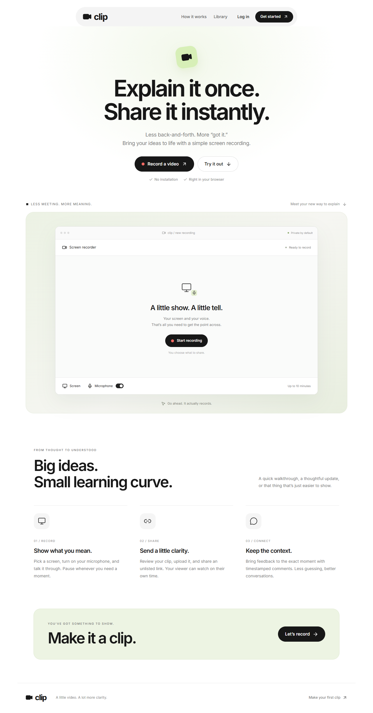
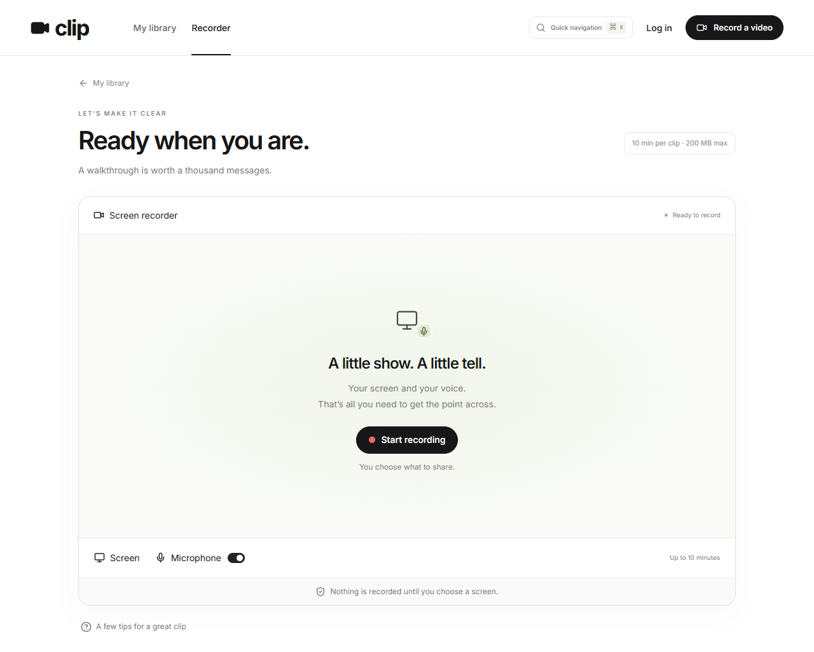
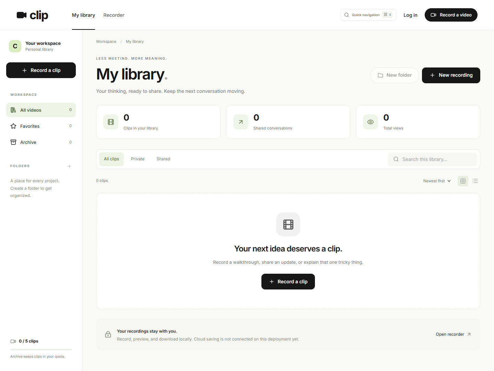
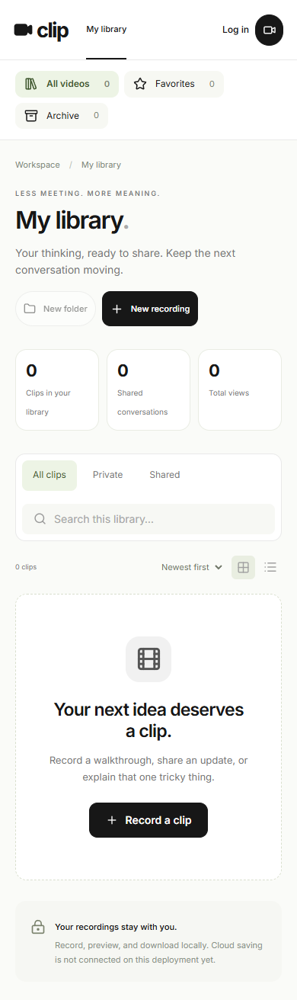
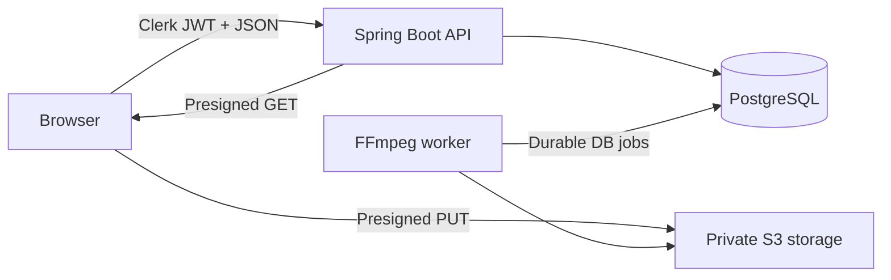

# Clip

### Explain it once. Share it instantly.

[Open the hosted preview](https://clip-six-red.vercel.app) · [Next implementation phase](docs/HIGH_HANDOFF.md)

The hosted preview is a frontend demo. Hosted API, database, worker, and video storage are not yet fully connected, and the preview uses Clerk development authentication. The workspace and collaboration changes below are implemented in this repository; deployment remains a separate phase.

Clip is a focused, end-to-end screen recording workspace for the moments when a paragraph is too slow and a meeting is too much. Record a walkthrough, upload it directly to private storage, let a durable FFmpeg worker prepare it, and share one clear link.

<p align="center">
  
</p>

<p align="center">
  <a href="#run-locally"><strong>Run it locally</strong></a>
  · <a href="#product-tour">Product tour</a>
  · <a href="docs/ARCHITECTURE.md">Architecture</a>
  · <a href="docs/API.md">API</a>
</p>

<p align="center">
  
  
  
  
</p>

## What works

- Browser screen capture with optional microphone/system audio, pause/resume, ten-minute guardrail, local preview, and download.
- Clerk sign-up, sign-in, sign-out, session management, and protected app routes without custom password storage.
- Spring Security validation of Clerk RS256 JWT signature, issuer, time, subject, authorized party, and session status.
- PostgreSQL persistence and Flyway migrations for users, videos, hashed share links, comments, durable jobs, and viewing sessions.
- Direct short-lived presigned uploads to private S3-compatible storage with server-side count, byte, MIME, ownership, and aggregate-storage quotas.
- Object verification followed by asynchronous `ffprobe` inspection, H.264/AAC MP4 output, thumbnails, retries, restart recovery, and abandoned-upload cleanup.
- Real library, upload progress, processing polling, playback, rename, delete, private seeking, playback URL refresh, and revocable unlisted links.
- Timestamped owner/guest comments with share authorization and guest rate limits.
- Threaded replies, signed-in author editing, author/owner deletion, and owner-controlled thread resolution.
- Five toggleable video reactions, participant mentions, and a persisted activity inbox with unread status.
- Personal folders, favorites, archive/restore, folder assignment, and responsive workspace navigation.
- Keyboard quick navigation (`Ctrl/Cmd+K`), loading skeletons, and desktop/mobile presentation checks.
- Deduplicated viewing-session aggregates for views, unique viewers, completion, percentage watched, and watch time.
- Completely free local infrastructure through Docker Compose: PostgreSQL, LocalStack S3, API, and FFmpeg worker.

No fake videos, successful-upload simulations, auth bypasses, storage secrets in JavaScript, Redis, Kafka, or dedicated CDN are used.

## Product tour

### Record in the browser

The browser asks the recorder to choose exactly what to share. Until upload begins, the recording remains local and can be reviewed or downloaded.

<p align="center">
  
</p>

### Keep the library close

Private videos move through honest uploading, processing, ready, and failed states. Search, filters, sorting, grid/list views, retry, sharing, comments, and analytics all use persisted backend data.

<p align="center">
  
</p>

### Designed to travel

The Mobbin-inspired layout keeps compact navigation, editorial type, soft gray surfaces, black pill actions, and a single green accent across desktop and mobile.

<p align="center">
  
</p>

## Architecture



PostgreSQL doubles as a small durable job queue through row locking. The API never holds an HTTP request open for processing. Full lifecycle, security boundaries, analytics definitions, and retry behavior are in [Architecture](docs/ARCHITECTURE.md).

## Run locally

### Requirements

- Node.js 22.13+ or another currently supported LTS
- Docker Desktop / Docker Engine with Compose v2
- A Clerk development application for authenticated workflows
- Java 21 only if running Spring outside Docker; the Maven wrapper is included

Copy the examples and fill the Clerk values:

```powershell
Copy-Item .env.example .env.local
Copy-Item backend/.env.example backend/.env
```

Then, in PowerShell:

```powershell
$env:CLERK_ISSUER = "https://your-instance.clerk.accounts.dev"
$env:CLERK_JWKS_URL = "$env:CLERK_ISSUER/.well-known/jwks.json"
docker compose up -d --build
npm ci
npm run dev
```

Open [http://127.0.0.1:3000](http://127.0.0.1:3000). See [Local development](docs/LOCAL_DEVELOPMENT.md) for macOS/Linux commands, Clerk origin setup, running infrastructure without credentials, and the real media smoke test.

Public pages and local recording build and run without Clerk keys. The auth page explains missing setup instead of crashing. The backend deliberately refuses to start without a Clerk issuer and has no production bypass.

## Validate

```powershell
npm run lint
npm run typecheck
npm run build
npm run test:ui
cd backend
.\mvnw.cmd test
```

With the Docker Compose stack already healthy, sign in locally and obtain a fresh Clerk token in the browser console with `await window.Clerk.session.getToken({ skipCache: true })`. Then immediately run the actual PostgreSQL/S3/FFmpeg lifecycle:

```powershell
$env:CLIP_TEST_TOKEN = "<current Clerk session token>"
.\scripts\verify-local-e2e.ps1
```

The operating-system screen picker and microphone permission still require a manual browser check.

## Configuration checklist

### Accounts to create later

| Account | Purpose | Current free-plan note |
| --- | --- | --- |
| Clerk | Authentication | Hobby publishes 50,000 monthly retained users/app; no credit card required. |
| Neon | Hosted PostgreSQL candidate | Free plan with limited per-project storage/compute and scale-to-zero; no credit card advertised. |
| Cloudflare | Private R2 object storage candidate | 10 GB-month Standard storage, 1M Class A, 10M Class B, free direct egress; usage billing can require a payment method. |
| Container host/VM | API + FFmpeg worker | No permanently-free worker hosting is promised; select and budget this at deployment time. |

Limits were reviewed on 2026-09-27. Details and official links are in [Future deployment](docs/DEPLOYMENT.md).

### Frontend: `.env.local`

| Variable | Visibility | Obtain from |
| --- | --- | --- |
| `NEXT_PUBLIC_API_URL` | public | Deployed Spring API origin; local is `http://localhost:8080`. |
| `NEXT_PUBLIC_CLERK_PUBLISHABLE_KEY` | public | Clerk Dashboard → API keys. |
| `CLERK_SECRET_KEY` | **secret** | Clerk Dashboard → API keys; used only by Next.js middleware. |

### API/worker: secret manager or `backend/.env`

| Variable | Visibility | Obtain from |
| --- | --- | --- |
| `DATABASE_URL` | secret/config | Neon connection details or local Compose JDBC URL. |
| `DATABASE_USERNAME`, `DATABASE_PASSWORD` | **secret** | Database role credentials. |
| `CLERK_ISSUER` | config | Clerk instance Frontend API URL. Required. |
| `CLERK_JWKS_URL` | config | Clerk issuer plus `/.well-known/jwks.json`. |
| `CLERK_AUTHORIZED_PARTIES` | config | Exact comma-separated frontend origins. |
| `S3_ENDPOINT`, `S3_PRESIGN_ENDPOINT`, `S3_REGION`, `S3_BUCKET` | config | LocalStack locally or R2 bucket/API settings. |
| `S3_ACCESS_KEY`, `S3_SECRET_KEY` | **secret** | Scoped private bucket credentials. |
| `FRONTEND_URL`, `ALLOWED_ORIGINS` | config | Exact public frontend URL/origins. |
| `WORKER_ENABLED` | config | `false` for API, `true` for worker. |
| `FFMPEG_PATH`, `FFPROBE_PATH`, `FFMPEG_TIMEOUT` | config | Worker image/tool paths and timeout. |
| `MAX_VIDEOS_PER_USER`, `MAX_VIDEO_BYTES`, `MAX_STORAGE_BYTES_PER_USER`, `MAX_VIDEO_DURATION_SECONDS` | config | Product quota policy. |

In Clerk, allow the exact local/production origins and redirect hosts used above. No Clerk webhook or custom JWT template is required. In storage, keep the bucket private and allow only exact frontend origins for `PUT`, `GET`, and `HEAD` CORS operations.

## Documentation

- [Architecture and security](docs/ARCHITECTURE.md)
- [HTTP API](docs/API.md)
- [Local development and verification](docs/LOCAL_DEVELOPMENT.md)
- [Troubleshooting](docs/TROUBLESHOOTING.md)
- [Future deployment and free-tier caveats](docs/DEPLOYMENT.md)
- [High reasoning handoff and remaining feature work](docs/HIGH_HANDOFF.md)

## Workspace and collaboration

| Product area | Clip today | Next phase |
| --- | --- | --- |
| Capture | Screen, microphone/system audio, pause/resume, local preview/download | Camera bubble, device controls, drawing, blur |
| Library | Personal folders, favorites, archive, title search, sorting, grid/list | Team spaces, transcript search, bulk operations |
| Conversation | Timestamped threads, replies, edit/delete, resolve, reactions, mentions | Email notifications, richer permissions, integrations |
| Video delivery | Private uploads, FFmpeg MP4/thumbnail jobs, revocable unlisted links | Complete hosted deployment, resumable upload |
| Editing and AI | Not implemented | Trim/stitch, custom thumbnails, captions, transcript editing, summaries/chapters |

This roadmap targets common workflows described in [Loom's feature comparison](https://www.loom.com/pricing), with Clip's own design and implementation. It does not claim complete Loom parity.

Create a folder using the library's **+** folder control, then move clips with the folder menu on each card. Star a clip for quick access, or archive it without deleting its media. Archived clips still count against the storage and video quota. Removing a folder leaves its videos intact.

On a ready video, start a timestamped thread, reply, or react. Signed-in authors can edit their own comments; authors and video owners can delete them. Owners can resolve and reopen threads. Guests can comment and reply through a valid unlisted link, while reactions and mentions require sign-in. Mention suggestions are limited to that video's creator and existing signed-in commenters. Mentions notify people but do not grant video access.

The bell opens the activity inbox for comments, replies, mentions, and reactions. Participants use the original share link to return to a shared video; a notification cannot bypass a revoked link. In-app notifications poll periodically; email delivery and team workspaces are not implemented yet.

Browser presentation checks run against an isolated server on port 3100 with Clerk disabled **only in that test process**. They do not test real sign-in or bypass authentication in the application. Run `npm run test:ui` with Microsoft Edge installed, or set `PLAYWRIGHT_CHANNEL=chrome`. PostgreSQL integration tests cover persistence and access boundaries with test-only JWT fixtures.

## Project map

```text
src/app/                    Next.js App Router pages
src/components/             Recorder, library, playback, auth, comments, analytics
src/lib/                    Typed browser API and domain types
backend/src/main/           Spring API, worker, domain model, Flyway migration
backend/src/test/           Security, service, retry, and Docker-gated PostgreSQL tests
infra/localstack/           Local S3 bucket initialization and CORS
compose.yml                 PostgreSQL, LocalStack S3, API, worker
scripts/verify-local-e2e.ps1 Real media workflow smoke test
docs/                       Architecture, API, setup, deployment, troubleshooting
```

## Verification boundary

Frontend lint/typecheck/build and backend non-container tests can run without hosted credentials. PostgreSQL migration and actual S3/FFmpeg verification require Docker. Clerk browser integration and the real smoke flow require user-provided development credentials. Screen capture permissions require manual interaction. The project does not claim deployed production verification.

## Built with

Next.js · React · TypeScript · Clerk · Spring Boot · Spring Security · PostgreSQL · Flyway · S3/LocalStack/R2 · FFmpeg
