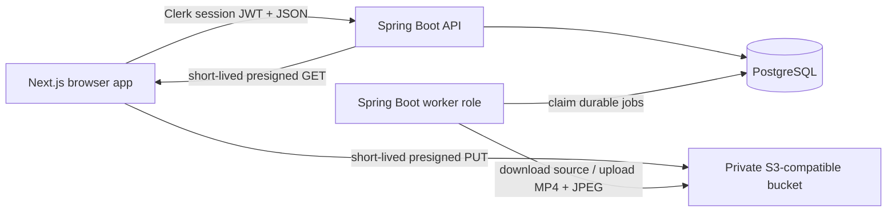

# Clip architecture

## System shape

Clip deliberately uses four runtime pieces and no message broker:

The API and worker use the same image. `WORKER_ENABLED=false` makes an API process; `WORKER_ENABLED=true` also polls jobs and performs cleanup. PostgreSQL supplies durable `FOR UPDATE SKIP LOCKED` job claiming, which is enough for the current five-video-per-user product limit and avoids operating Kafka or Redis.

## Core workflow

1. The browser records real media with `MediaRecorder` and keeps a local object URL for preview.
2. `POST /api/videos` checks the authenticated owner, MIME type, declared bytes, five-video quota, and 1 GiB aggregate quota. It records an `UPLOADING` row and returns a 15-minute, content-type-bound S3 PUT URL.
3. The browser PUTs the bytes directly. Storage credentials never reach JavaScript.
4. `POST /api/videos/{id}/complete` HEADs the private object. Exact size and normalized content type must match before the video becomes `PROCESSING` and a durable job is queued. Repeated completion is idempotent.
5. A worker claims one queued row, downloads the source into a unique OS temporary directory, and runs `ffprobe`. A real video stream and a duration from 0–600 seconds are required.
6. FFmpeg emits H.264/AAC MP4 with `faststart` and a JPEG thumbnail. Deterministic destination keys make retries safe. The worker marks the video `READY` only after both uploads finish.
7. Owner and share playback return 15-minute S3 GET URLs. S3 range requests provide seeking; the client asks the API for a replacement URL after a media error.
8. Deletion removes source, playback, and thumbnail objects before deleting the video. Database cascades remove jobs, share links, comments, and viewing sessions.

Abandoned `UPLOADING` rows and their possible source objects are removed after 24 hours. A worker restarts `RUNNING` jobs whose locks are older than 15 minutes. Failures retry with backoff and become `FAILED` after three attempts; owners can explicitly queue another retry.

## Authentication and authorization

Clerk owns sign-up, sign-in, sign-out, and browser sessions. The frontend obtains the current session JWT with Clerk's `getToken()` and sends it as `Authorization: Bearer …`.

Spring Security verifies RS256 signatures through the instance JWKS, issuer, timestamps, non-empty subject, optional Clerk `azp` against `CLERK_AUTHORIZED_PARTIES`, and rejects `sts=pending`. The API refuses to start if `CLERK_ISSUER` is absent. There is no runtime auth bypass. Mock JWTs exist only inside the test source set.

This follows Clerk's [Next.js quickstart](https://clerk.com/docs/getting-started/quickstart) for `proxy.ts` and route protection and its [manual JWT verification guidance](https://clerk.com/docs/guides/sessions/manual-jwt-verification) for JWKS, RS256, time claims, `azp`, and `sts` validation.

The first authenticated call creates an application user keyed by the immutable Clerk subject. The browser then syncs that user's current display name and primary email. Every private lookup includes both video ID and application owner ID. Share links use 256-bit random tokens; only SHA-256 hashes are stored.

## Data model

- `app_users`: application profile keyed by unique Clerk user ID.
- `videos`: owner, lifecycle status, private object keys, declared upload facts, probed duration, optimistic version.
- `share_links`: one link per video, hash only, revocation timestamp.
- `comments`: timestamped owner or named-guest comments; cascades with the video.
- `processing_jobs`: durable state, attempts, retry time, and restart lock information.
- `viewing_sessions`: bounded aggregates rather than a row for every playback heartbeat.

Flyway owns versioned schema changes. JPA runs in `validate` mode and never mutates production schema.

## Analytics semantics

- **View:** one playback session after the player reaches two seconds. Reloading creates another session; heartbeats do not.
- **Unique viewer:** distinct one-way SHA-256 identifier per video. Signed-in users use the opaque Clerk subject; guests use the browser's random UUID. Raw identifiers and IP addresses are not persisted.
- **Watch time:** forward playback deltas capped at 15 seconds per heartbeat and never above video duration. Seeking does not add the skipped interval.
- **Completion:** an explicit ended event or reaching at least 90% of duration.
- **Average watched:** each session's maximum reached position divided by probed duration.

The browser sends progress at most every 12 seconds. One row is updated per session, preventing event-row explosions. Guest analytics and comments have per-instance, per-IP-hash minute limits (60 and 10 respectively); a multi-instance deployment should move rate limiting to the platform edge or a shared limiter.

## Security boundaries

- Buckets stay private; every media operation is object-specific and expires.
- Upload completion distrusts browser declarations and processing distrusts object metadata.
- Quotas are checked server-side before signing.
- Guest access always resolves a live, unrevoked link for the same video.
- CORS origins, Clerk authorized parties, and storage CORS are separate allowlists and must all match the frontend origins.
- Secrets are backend-only. Only `NEXT_PUBLIC_API_URL` and `NEXT_PUBLIC_CLERK_PUBLISHABLE_KEY` are exposed to the browser.
