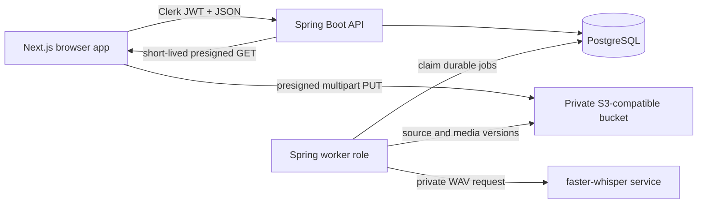

# Clip architecture

## System shape

Clip uses five local runtime roles and no message broker:

The API and media worker use the same image. `WORKER_ENABLED=false` is the API role; `true` enables media/transcript polling, stale-job recovery, and cleanup. PostgreSQL provides durable `FOR UPDATE SKIP LOCKED` queues, avoiding Redis or Kafka at the current small-workspace scale. The speech container is private to the Compose network and never fetches user URLs.

## Capture and upload

1. The browser captures screen, camera, or both into a canvas, mixes permitted audio tracks, and records the composed frames with `MediaRecorder`.
2. Recording chunks and metadata are written to IndexedDB. Refresh recovery is local to that browser profile; no upload starts until the user chooses it.
3. `POST /api/videos` locks the creator row, checks normalized MIME, count, source-size, and aggregate declared-source quotas, creates an `UPLOADING` row, and returns a short-lived single PUT URL.
4. The current client starts/resumes S3 multipart upload. The API lists server-observed parts and signs only missing 8 MiB chunks. Completion validates every part number and size before asking S3 to assemble the object.
5. The API HEADs the private object. Exact size and normalized content type must match before it changes to `PROCESSING` and queues a durable job.

Abandoned uploads and multipart sessions are removed after 24 hours. Storage credentials never reach JavaScript; presigned URLs are narrow bearer credentials with configurable lifetimes.

## Media processing and revisions

A worker atomically claims one queued job. Initial processing downloads the source, uses `ffprobe` to require a real video stream and a duration within quota, then emits H.264/AAC MP4 plus JPEG thumbnail. An edit job validates all source clip ownership/ranges before persisting its plan, then FFmpeg renders normalized segments, framing, blur/box regions, overlay text, audio, and the requested thumbnail.

Every output uses a unique `videos/{id}/revisions/{revision}/{attempt}/` prefix. The database publishes only the matching claimed attempt; stale/obsolete attempts cannot replace playable media. Existing output stays live while a revision renders. `media_versions` retains up to the product's ten-revision cap, share URLs remain stable, and shared viewers can request only the published revision. Deleting a clip removes its full object prefix plus the source.

Jobs retry with backoff and fail after three attempts. Locks older than 15 minutes are requeued. Owners can manually reset a failed attempt budget. The API never holds an HTTP request open for processing.

## Transcription

The worker queues transcription only for a published ready revision. It downloads private playback, extracts bounded mono 16 kHz WAV with FFmpeg, and POSTs bytes to the private speech service. faster-whisper returns word timestamps; it receives no storage credentials or public URL. Results are written only when the revision and claimed attempt still match.

The API adds deterministic, explicitly labeled suggestions: extractive summary/title, time-spaced chapters, phrase-matched action items, possible credential/email review ranges, and silence/filler cuts. Users can edit transcript segments. These heuristics do not make factual or privacy guarantees.

## Authentication, tenancy, and sharing

Clerk owns accounts, sessions, and Organizations. Spring Security verifies RS256/JWKS signature, issuer, time claims, subject, authorized party, and session status. The API refuses to start without `CLERK_ISSUER`; test JWTs exist only under test sources.

Without an Organization claim, queries are scoped to the creator's personal rows. With `org_id`, list/read queries are scoped to that tenant. Clip creators and Organization admins perform media/folder mutations; members can read the active team library. Switching Clerk Organizations obtains a token with the new claims, and the frontend remounts workspace state.

Share links use 256-bit random tokens and store only SHA-256 hashes. Optional passwords are bcrypt hashes and expiry is checked on every shared API request. Revocation/rotation is immediate. A notification, embed, comment ID, or media revision never bypasses a live share check.

## Core data

- `app_users`: local profile keyed by immutable Clerk subject.
- `videos`: owner/tenant, lifecycle, source/current keys, organization state, edit plan, published/media revisions, transcript and CTA metadata.
- `media_versions`: immutable revision duration and object keys.
- `processing_jobs`, `transcript_jobs`: durable queue state and attempt identity.
- `share_links`: token hash, bcrypt password hash, expiry, and revocation.
- `folders`, `comments`, `reactions`, `notifications`: collaboration state; comments carry their media revision.
- `viewing_sessions`: revision-scoped watched-range aggregates.

Flyway owns schema changes. Hibernate runs with `ddl-auto=validate` and never mutates production schema.

## Analytics semantics

- **View:** one durable player session; heartbeats update it rather than adding event rows.
- **Unique viewer:** distinct SHA-256 pseudonym. Raw Clerk subjects, browser viewer IDs, and IP addresses are not stored in analytics.
- **Watch coverage/time:** a bounded bitset of actually traversed forward ranges. Seeking and replaying the same range do not inflate it.
- **Completion:** an ended event after real watch progress or sufficient covered media, rather than simply seeking to the end.
- **Engagement:** number of sessions whose watched ranges overlap each interval in the published revision.

The browser reports at most every 12 seconds. Guest comments and progress have per-instance hashed-address limits; signed-in mutations have a subject limit. Replace this with an edge/shared limiter before horizontal API scaling.

## Security boundaries

- Buckets are private; media access is object-specific and expires.
- Upload completion distrusts client declarations, and processing distrusts object metadata.
- Every controller mutation delegates to service-level authentication, tenant, and resource authorization.
- CORS, Clerk authorized parties, storage CORS, and embed framing are separate allowlists/policies.
- The default page CSP blocks framing; only `/embed/*` permits it.
- Secrets remain server-side. Browser-exposed variables are limited to the public API origin and Clerk publishable key.
- Transcript and render errors shown to shared viewers are minimized; internal job details stay with managers.
